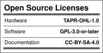
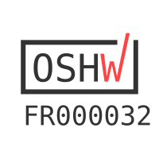

# minus

**A minimal, single-channel, low-cost, open-source ultrasound pulse-echo platform —
built as a conference-workshop badge.**

`minus` drives one piezo transducer with a high-voltage pulse, amplifies and digitizes
the returning echo, and streams the raw data to a host. It is designed to be **cheap,
small, simple, and hackable**: a badge attendees can use in an ultrasound-conference
workshop (e.g. **muscle-contraction monitoring**, A-/M-mode) and then extend and
experiment with (coded excitation, on-device DSP, add-on boards). See [`docs/intended-use.md`](docs/intended-use.md).

> ⚠️ **Status: working prototype (minus v1.1, board 3).** Pulse-echo, the
> switchable RX gain, the fixed-pattern correction and the RGB LED work on the bench, and the
> [datasheet rev 0.3](datasheet/minus-datasheet.pdf) gives measured figures, errata, the on-PIC processing
> (envelopes step by step, band-pass envelope `envbp`) and the test transducer (Annex A). Firmware RP2354A **1.1.9**, PIC32AK **1.1.6**, link protocol **15** (capture payload over SPI; on-PIC time of flight, envelope, band-pass envelope, oversampling; time-gain steps; live viewer `python3 -m minus.live`).
> Source: <https://github.com/kelu124/minus>.
> **OSHWA-certified open source hardware, UID [FR000032](https://certification.oshwa.org/fr000032.html)**
> (2026-11-20); the mark and UID are on the front silkscreen.
> Non-clinical, for **research / education / NDT** only; not a medical device.


## What it is (at a glance)

- **Two MCUs:** a Raspberry Pi **RP2354A** (USB-C console, pulse timing via PIO, gain mux,
  LP5562 RGB LED over I²C, ICSP programmer for the PIC) and a Microchip **PIC32AK1216GC41048** (on-chip
  ADCs and op amps: captures the A-line, 4095 samples at up to ~25 Msps).
- **Front end:** TC4427/MIC4427-driven 3-level pulser → protected RX (10 nF DC block, BAV99 clamp) →
  24 dB LNA (BGA2817, nominal) + 9-step switchable 0–42.5 dB op-amp gain (two on-chip stages, feedback legs via a
  4052 mux, ×1 bypass; measured), ≈ 24–66 dB total → PIC 12-bit ADC.
- **Transducer:** 3–4 MHz single-element piezo, separate TX and RX connectors (SMA + U.FL); raw RF A-mode.
  The probe used for all measurements is characterised from its S11 in datasheet Annex A
  ([`datasheet/piezo_test/`](datasheet/piezo_test/)).
- **Open:** open hardware + firmware + docs, designed for JLCPCB fabrication
  (see [LICENSE.md](LICENSE.md)); OSHWA certified, UID [FR000032](https://certification.oshwa.org/fr000032.html).

## Repository map

| Path | What's there |
|------|--------------|
| [`hardware/`](hardware/) | KiCad project of the current board (`minUS.kicad_pro`, minus v1.1), [`production/`](hardware/production/) JLCPCB outputs (Gerbers zip, BOM, positions), 3D renders + [`render_3d.py`](hardware/render_3d.py). |
| [`firmware/`](firmware/README.md) | `rp2354/` (pico-sdk) and `pic32/` (XC-DSC) sources, **built images committed** in `*/build/`, [`VERSIONS.md`](firmware/VERSIONS.md). |
| [`python/`](python/README.md) | `minus` Python library (one method per CLI command, firmware-sync check, offline tests) + step-by-step [notebooks](python/notebooks/). |
| [`datasheet/`](datasheet/) | Product datasheet rev 0.3 (LaTeX source, generated values/figures, [`minus-datasheet.pdf`](datasheet/minus-datasheet.pdf)); [`piezo_test/`](datasheet/piezo_test/) = test-probe S11 (Annex A). |
| [`docs/intended-use.md`](docs/intended-use.md) | Intended use (workshop badge, research / education / NDT). |
| [`docs/costs/`](docs/costs/) | BOM cost sheet ([`cost_bom.xls`](docs/costs/cost_bom.xls)). |
| [`docs/bench/`](docs/bench/) | Bench campaigns: raw captures, capture/analysis scripts and a README per campaign (pulse-echo, gain, noise, pattern correction, datasheet, [E3 comb-phase jitter](docs/bench/2026-11-19-jitter/)). |
| [`docs/claude/`](docs/claude/README.md) | Working notes: session logs, decision memory, TODO/DONE, changelog. |
| [`TODO_HARDWARE.md`](TODO_HARDWARE.md) | Corrections queued for the next board revision. |
| [`LICENSE.md`](LICENSE.md), [`LICENSES/`](LICENSES/) | Per-folder licenses. |

Earlier material (the requirements and trade studies, the survey of comparable systems,
reference designs, the devkit and intermediate boards, and source PDFs) was removed on
2026-11-19 to keep the tree focused. It is still in the git history before that date.

## Getting started

### Requirements (tested on Ubuntu 22.04, x86-64)

**Flashing only** (the images are prebuilt): a USB-C cable and nothing else. The RP2354A
takes the `.uf2` over its USB bootloader, and then programs the PIC itself.

**Building the RP2354A firmware:**
- [pico-sdk](https://github.com/raspberrypi/pico-sdk) **2.1.0** with `PICO_SDK_PATH` set,
  `arm-none-eabi-gcc`, `cmake`, `ninja`.
- `picotool` (2.3.0 tested) is optional: you can copy the `.uf2` to the boot drive instead.

**Building the PIC32AK firmware.** The PIC32AK is a dsPIC33A-core part, so it is compiled by
**MPLAB XC-DSC**, not XC32:
1. **MPLAB XC-DSC ≥ 3.31.01** (3.31.01 tested, it lists `32AK1216GC41048`). Get the Linux `.run`
   from <https://www.microchip.com/xcdsc>, `chmod +x` it, run it with `sudo` (it installs to
   `/opt/microchip/xc-dsc/vX.YY`), then add its `bin/` to `PATH`.
2. **Device Family Pack `Microchip.PIC32AK-GC_DFP`** (1.1.53 tested) from
   <https://packs.download.microchip.com/>. The `.atpack` is a zip: unpack it to
   `~/microchip/packs/PIC32AK-GC_DFP/1.1.53/`. MPLAB X can also install it (*Tools → Packs*).

No Microchip programmer and no MPLAB X are needed: board v1.1 has **no ICSP / Tag-Connect header**,
and the RP2354A is the only PIC programmer (`pic flash`, bit-banged ICSP on GPIO21/22/24). A recovery
ICSP header for the next revision is listed in [`TODO_HARDWARE.md`](TODO_HARDWARE.md).

`make -C firmware/pic32 info` shows the XC-DSC / MPLAB X / DFP paths the build will use. The
Makefile already passes the two flags XC-DSC needs for this part: the device linker script
`-T <DFP>/xc32/support/PIC32A/gld/p32AK1216GC41048.gld` and `-mdfp=` for `xc-dsc-bin2hex`.

**Python library, bench scripts, datasheet:** Python 3 with `pyserial` and `numpy` (plus `matplotlib` and
`jupyter` for the notebooks and plots); `pdflatex` for the datasheet (`make -C datasheet`).

### Build

```bash
make -C firmware/pic32                        # -> firmware/pic32/build/minus_pic.hex
cmake -S firmware/rp2354 -B firmware/rp2354/build -G Ninja -DCMAKE_BUILD_TYPE=Release
cmake --build firmware/rp2354/build -j        # -> firmware/rp2354/build/minus_rp.uf2
```

Build the PIC **first**: the RP image embeds the PIC hex (`tools/hex2c.py` → `build/pic_image.c`).
`make -C firmware` builds both, in that order. Commit the two images with every version bump
(see [`firmware/VERSIONS.md`](firmware/VERSIONS.md)).

### Flash and test

1. **RP2354A:** hold BOOTSEL (SW2) and tap RUN (SW1). If a firmware is already running, type
   `reboot dfu` on its console instead. A UF2 drive appears: copy
   `firmware/rp2354/build/minus_rp.uf2` onto it, or run `picotool load -x firmware/rp2354/build/minus_rp.uf2`.
   Wait for `/dev/ttyACM0` to come back.
2. **Console:** `picocom /dev/ttyACM0` (any baud; it is USB CDC), or one-shot from a script with
   `python3 firmware/rp2354/tools/rpcli.py /dev/ttyACM0 "version" --wait=1`. Type `help` for the
   command list, then `version` and check the version numbers **before** going further.
3. **PIC32AK, from the RP:** `pic id` must print `… DEVID 0x9da2 DEVREV 2 -> PIC32AK1216GC41048`, then run
   `pic flash` (erase, program, verify, ~1 s). It writes the PIC image embedded in the RP firmware,
   so check `version` first.
4. **Link check:** `ping` → `ok`; `raw ID?` → `PIC32AK1216GC41048 minus-pic32 1.1.6 proto 15`; `rgb 0 255 0` → LED green (25 % brightness by default; `rgb 0 255 0 100` = full).
5. **Pulse-echo:** `pe` fires the pulser and captures one A-line, and `gain [leg [u1 [u2]]]` sets
   the RX gain. The full command reference and pin map are in
   [`firmware/README.md`](firmware/README.md). Measurement campaigns to reproduce are in
   [`docs/bench/`](docs/bench/).
6. **From Python:** `pip install -e python/library`, then follow [`python/notebooks/`](python/notebooks/) — new to
   ultrasound? start with [`00_acquisition_101.ipynb`](python/notebooks/00_acquisition_101.ipynb) (workshop notebook)
   (`from minus import Minus; dev = Minus(); dev.pe()`). See [`python/README.md`](python/README.md).

## Known limitations

The full list is in the datasheet errata; the ones that matter when you use the data:
- **Sample-comb phase (E3):** the pulse falls anywhere within one 40 ns sample from shot to shot, and in 14–31 % of captures
  the comb slips by a whole sample during the capture. Align shots on the echo of interest before averaging
  ([`docs/bench/2026-11-19-jitter/`](docs/bench/2026-11-19-jitter/)).
- **ADC slow lock (E2):** detected on the PIC; `pe` and `acq` re-shoot automatically.
- **Frame rate:** the capture crosses the RP↔PIC SPI link in 5.7 ms; a full 4095-sample `pe` takes ~31 ms end to end from
  Python (~23 A-lines/s in the live viewer, ~36/s with the on-PIC envelope). The 4052 gain switch costs ~17 µs per TGC step.
- **TX and RX are separate nets:** a single-element probe on one connector needs an external tee for now.

## Keeping firmware and Python in sync

`python/library` is checked against the firmware sources (commands, `help` usages, link protocol, versions, a fingerprint
of every source file) by `python -m minus.fwsync`. It runs automatically after firmware edits in Claude Code and on
`git commit`; enable the git hook once per clone with `git config core.hooksPath .githooks`. Details in
[`python/README.md`](python/README.md).

## Lineage & credits

`minus` builds on the open single-channel ultrasound work of **Luc Jonveaux (kelu124)**:
[echomods/Murgen](https://github.com/kelu124/echomods),
[un0rick](https://github.com/kelu124/un0rick),
[lit3rick](https://github.com/kelu124/lit3rick), and
[pic0rick](https://github.com/kelu124/pic0rick). It reuses their proven building blocks
to reduce risk.

## License

Hardware: TAPR OHL v1.0. Firmware, Python library and scripts: GPL-3.0-or-later. Documentation, datasheet and
bench data: CC-BY-SA-4.0. Details and third-party exceptions are in [LICENSE.md](LICENSE.md).


<a href="https://certification.oshwa.org/fr000032.html"></a>

Certified by the Open Source Hardware Association as **[FR000032](https://certification.oshwa.org/fr000032.html)**
("minUS - low cost pic32/rp2354 pulse-echo", 2026-11-20). The certification mark is used under the
[OSHWA mark license agreement](https://certification.oshwa.org/license-agreement.html); its source files are in
[`hardware/certification-mark/`](hardware/certification-mark/).
