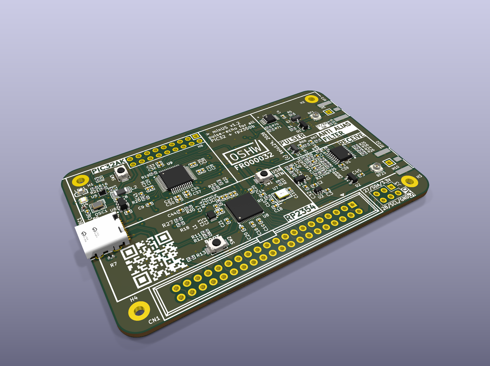

# minus

**A minimal, single-channel, low-cost, open-source ultrasound pulse-echo platform —
built as a conference-workshop badge.**

`minus` drives one piezo transducer with a high-voltage pulse, amplifies and digitizes
the returning echo, and streams the raw data to a host. It is designed to be **cheap,
small, simple, and hackable**: a badge attendees can use in an ultrasound-conference
workshop (e.g. **muscle-contraction monitoring**, A-/M-mode) and then extend and
experiment with (coded excitation, on-device DSP, add-on boards).

> ⚠️ **Status: working prototype (minus v1.1, board `minUS_08112026`).** Pulse-echo, the
> switchable RX gain and the fixed-pattern correction work on the bench, and the
> [datasheet rev 0.1](datasheet/minus-datasheet.pdf) gives measured figures.
> Board **minus v1.1**; firmware RP2354A **1.1.1**, PIC32AK **1.1.0**, link protocol **10**.
> Non-clinical, for **research / education / NDT** only; not a medical device.



## What it is (at a glance)

- **Two MCUs:** a Raspberry Pi **RP2354A** (USB-C console, pulse timing via PIO, RGB LED,
  digipots, ICSP programmer for the PIC) and a Microchip **PIC32AK1216GC41048** (on-chip
  ADCs and op amps: captures the A-line, 4095 samples at up to ~25 Msps).
- **Front end:** TC4427/MIC4427-driven 3-level pulser → protected RX → two-stage op-amp gain
  (4 legs per stage via analog mux, ×1 bypass) → PIC ADC.
- **Transducer:** 3–4 MHz single-element piezo; raw RF A-mode.
- **Open:** open hardware + firmware + docs, designed for JLCPCB fabrication
  (see [LICENSE.md](LICENSE.md)).

## Repository map

| Path | What's there |
|------|--------------|
| [`hardware/`](hardware/) | KiCad project of the current board (`minUS.kicad_pro`, board 3 = `minUS_08112026`), [`production/`](hardware/production/) JLCPCB outputs (Gerbers zip, BOM, positions), 3D renders + [`render_3d.py`](hardware/render_3d.py). |
| [`firmware/`](firmware/README.md) | `rp2354/` (pico-sdk) and `pic32/` (XC-DSC) sources, **built images committed** in `*/build/`, [`VERSIONS.md`](firmware/VERSIONS.md). |
| [`python/`](python/README.md) | `minus` Python library (one method per CLI command, firmware-sync check, offline tests) + step-by-step [notebooks](python/notebooks/). |
| [`datasheet/`](datasheet/) | Product datasheet (LaTeX source, figures, [`minus-datasheet.pdf`](datasheet/minus-datasheet.pdf)). |
| [`docs/bench/`](docs/bench/) | Bench campaigns: raw captures, capture/analysis scripts and a README per campaign. |
| [`docs/claude/`](docs/claude/README.md) | Working notes: session logs, decision memory, TODO/DONE, changelog. |
| [`TODO_HARDWARE.md`](TODO_HARDWARE.md) | Corrections queued for the next board revision. |
| [`LICENSE.md`](LICENSE.md), [`LICENSES/`](LICENSES/) | Per-folder licenses. |

Earlier material (the requirements and trade studies, the survey of comparable systems,
reference designs, the devkit and intermediate boards, and source PDFs) was removed on
2026-11-19 to keep the tree focused. It is still in the git history before that date.

## Getting started

### Requirements (tested on Ubuntu 22.04, x86-64)

**Flashing only** (the images are prebuilt): a USB-C cable and nothing else. The RP2354A
takes the `.uf2` over its USB bootloader, and then programs the PIC itself.

**Building the RP2354A firmware:**
- [pico-sdk](https://github.com/raspberrypi/pico-sdk) **2.1.0** with `PICO_SDK_PATH` set,
  `arm-none-eabi-gcc`, `cmake`, `ninja`.
- `picotool` (2.3.0 tested) is optional: you can copy the `.uf2` to the boot drive instead.

**Building the PIC32AK firmware.** The PIC32AK is a dsPIC33A-core part, so it is compiled by
**MPLAB XC-DSC**, not XC32:
1. **MPLAB XC-DSC ≥ 3.31.01** (3.31.01 tested, it lists `32AK1216GC41048`). Get the Linux `.run`
   from <https://www.microchip.com/xcdsc>, `chmod +x` it, run it with `sudo` (it installs to
   `/opt/microchip/xc-dsc/vX.YY`), then add its `bin/` to `PATH`.
2. **Device Family Pack `Microchip.PIC32AK-GC_DFP`** (1.1.53 tested) from
   <https://packs.download.microchip.com/>. The `.atpack` is a zip: unpack it to
   `~/microchip/packs/PIC32AK-GC_DFP/1.1.53/`. MPLAB X can also install it (*Tools → Packs*).
3. **MPLAB X IDE** (6.35 tested): only needed to flash the PIC with a Microchip tool, through
   `ipecmd`. Keep "MPLAB IPE" ticked in the installer. It takes ~3 GB and also installs ~8 GB of
   device packs, so keep ≥ 2 GB free on `/`. For programmer access without root, install
   Microchip's udev rules (`/etc/udev/rules.d/z010_mchp_tools.rules`), then run
   `sudo udevadm control --reload && sudo udevadm trigger` and replug.
4. **Optional Microchip programmer** on J1 (Tag-Connect TC2030-NL, ICSP pinout 1 MCLR · 2 VDD ·
   3 GND · 4 PGD · 5 PGC · 6 NC). MPLAB **Snap** or **PICkit Basic** (~€30 each), or PICkit 4/5,
   ICD 4/5, ICE 4. These do not power the target, so keep the board on USB-C. In normal use the
   RP2354A programs the PIC (`pic flash`), so you don't need one.

`make -C firmware/pic32 info` shows the XC-DSC / MPLAB X / DFP paths the build will use. The
Makefile already passes the two flags XC-DSC needs for this part: the device linker script
`-T <DFP>/xc32/support/PIC32A/gld/p32AK1216GC41048.gld` and `-mdfp=` for `xc-dsc-bin2hex`.

**Bench scripts / datasheet:** Python 3 with `numpy`, `matplotlib`, `pyserial`;
`pdflatex` for the datasheet (`make -C datasheet`).

### Build

```bash
make -C firmware/pic32                        # -> firmware/pic32/build/minus_pic.hex
cmake -S firmware/rp2354 -B firmware/rp2354/build -G Ninja -DCMAKE_BUILD_TYPE=Release
cmake --build firmware/rp2354/build -j        # -> firmware/rp2354/build/minus_rp.uf2
```

Build the PIC **first**: the RP image embeds the PIC hex (`tools/hex2c.py` → `build/pic_image.c`).
`make -C firmware` builds both, in that order. Commit the two images with every version bump
(see [`firmware/VERSIONS.md`](firmware/VERSIONS.md)).

### Flash and test

1. **RP2354A:** hold BOOTSEL (SW2) and tap RUN (SW1). If a firmware is already running, type
   `reboot dfu` on its console instead. A UF2 drive appears: copy
   `firmware/rp2354/build/minus_rp.uf2` onto it, or run `picotool load -x firmware/rp2354/build/minus_rp.uf2`.
   Wait for `/dev/ttyACM0` to come back.
2. **Console:** `picocom /dev/ttyACM0` (any baud; it is USB CDC), or one-shot from a script with
   `python3 firmware/rp2354/tools/rpcli.py /dev/ttyACM0 "version" --wait=1`. Type `help` for the
   command list, then `version` and check the version numbers **before** going further.
3. **PIC32AK, from the RP:** `pic id` must print `DEVID 0x09da2053 … PIC32AK1216GC41048`, then run
   `pic flash` (erase, program, verify, ~1 s). It writes the PIC image embedded in the RP firmware,
   so check `version` first. With a Microchip tool on J1 instead:
   `make -C firmware/pic32 flash TOOL=SNAP` (or `PKBASIC`, `PK4`, `PK5`, `ICD4`, `ICD5`, `ICE4`).
4. **Link check:** `ping` → `ok`; `raw ID?` → `PIC32AK1216GC41048 minus-pic32 1.1.0 proto 10`; `rgb 0 40 0` → LED green.
5. **Pulse-echo:** `pe` fires the pulser and captures one A-line, and `gain [leg [u1 [u2]]]` sets
   the RX gain. The full command reference and pin map are in
   [`firmware/README.md`](firmware/README.md). Measurement campaigns to reproduce are in
   [`docs/bench/`](docs/bench/).
6. **From Python:** `pip install -e python/library`, then follow [`python/notebooks/`](python/notebooks/)
   (`from minus import Minus; dev = Minus(); dev.pe()`). See [`python/README.md`](python/README.md).

## Lineage & credits

`minus` builds on the open single-channel ultrasound work of **Luc Jonveaux (kelu124)**:
[echomods/Murgen](https://github.com/kelu124/echomods),
[un0rick](https://github.com/kelu124/un0rick),
[lit3rick](https://github.com/kelu124/lit3rick), and
[pic0rick](https://github.com/kelu124/pic0rick). It reuses their proven building blocks
to reduce risk.

## License

Hardware: TAPR OHL v1.0. Firmware, Python library and scripts: GPL-3.0-or-later. Documentation, datasheet and
bench data: CC-BY-SA-4.0. Details and third-party exceptions are in [LICENSE.md](LICENSE.md).
